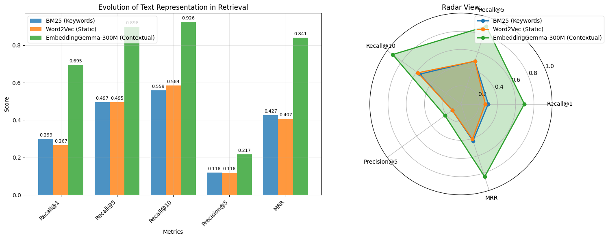
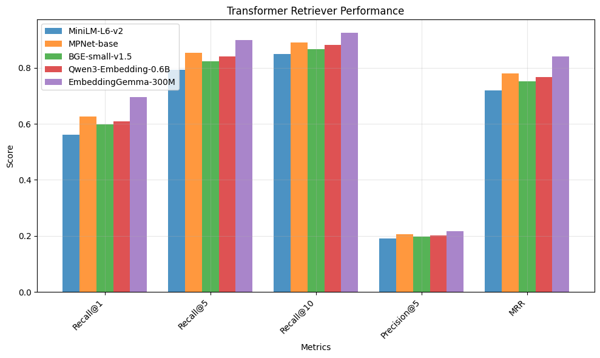

# Open-Domain QA: Keyword to Transformer Retrieval

A retriever → reader question-answering pipeline on **Natural Questions**,
benchmarking three generations of retrieval: keyword search, static word
embeddings, and transformer embedders from 2021 to 2025.

The best retriever finds the relevant passage in its top 5 for **92% of
questions**, and an extractive reader pulls the answer span from those
passages.

```
Question ──► Retriever (top-k passages) ──► Reader (answer span) ──► Answer + source passage
```

---

## Results

All 3,452 NQ test questions, searched over **104,201 passages**: the 4,201
relevant passages plus 100,000 random distractors from the 2.68M-passage
collection. Run on a Kaggle Tesla T4.

| Retriever | Recall@1 | Recall@5 | Recall@10 | Precision@5 | MRR |
|---|---|---|---|---|---|
| **EmbeddingGemma-300M** | **0.695** | **0.898** | **0.926** | **0.217** | **0.841** |
| MPNet-base | 0.626 | 0.854 | 0.891 | 0.206 | 0.781 |
| Qwen3-Embedding-0.6B | 0.609 | 0.840 | 0.881 | 0.202 | 0.767 |
| BGE-small-v1.5 | 0.597 | 0.823 | 0.866 | 0.198 | 0.751 |
| MiniLM-L6-v2 | 0.560 | 0.793 | 0.848 | 0.191 | 0.719 |
| Hybrid (BM25 + EmbeddingGemma, RRF) | 0.437 | 0.804 | 0.905 | 0.191 | 0.642 |
| BM25 | 0.299 | 0.497 | 0.559 | 0.118 | 0.427 |
| Word2Vec (tuned) | 0.267 | 0.495 | 0.584 | 0.118 | 0.407 |

**End-to-end QA** (EmbeddingGemma top-5 → `deepset/roberta-base-squad2`, 500
questions): the relevant passage is in the top 5 for **92.2%** of questions,
and the reader takes its answer from that passage **45.8%** of the time.

Raw numbers are in [`results/metrics.json`](results/metrics.json); the full
run, with every output, is [`notebooks/open_domain_qa.ipynb`](notebooks/open_domain_qa.ipynb).



### Cost per model

| Model | Dim | Index 104K passages | 3,452 queries | MRR |
|---|---|---|---|---|
| EmbeddingGemma-300M | 768 | 1,723 s | 14.4 s | 0.841 |
| MPNet-base | 768 | 1,142 s | 9.9 s | 0.781 |
| Qwen3-Embedding-0.6B | 1024 | 1,765 s | 20.1 s | 0.767 |
| BGE-small-v1.5 | 384 | 333 s | 5.8 s | 0.751 |
| MiniLM-L6-v2 | 384 | 171 s | 4.8 s | 0.719 |

MiniLM indexes 10× faster than EmbeddingGemma and reaches 85% of its MRR.



---

## Findings

* **Transformers roughly double keyword search.** EmbeddingGemma's MRR is
  0.841 against BM25's 0.427, and the gap is widest at Recall@1.
* **Newer and bigger is not a straight line.** The 300M-parameter
  EmbeddingGemma beats the 600M-parameter Qwen3-Embedding, and the 2021
  MPNet-base beats both BGE-small and Qwen3.
* **Naive hybrid search hurt.** Fusing BM25 with EmbeddingGemma by Reciprocal
  Rank Fusion lowered MRR by 0.20 relative to EmbeddingGemma alone, most
  likely because equal-weight fusion with a much weaker ranking pulls correct
  dense results down.
* **Word2Vec is sensitive to its settings.** A four-configuration search
  (best: skip-gram, 300 dimensions, `min_count` 3, 20 epochs) took MRR from
  0.099 to 0.407, close to BM25.

### Caveats

* The corpus is a 104K-passage subset, not the full 2.68M collection, so these
  scores are higher than published full-corpus BEIR numbers and are best read
  as a comparison between retrievers.
* The Word2Vec search was tuned on the same queries it is scored on, so its
  number is optimistic.

---

## Layout

```
notebooks/open_domain_qa.ipynb   the full benchmark and QA run, with outputs
src/
  data_loader.py           BEIR NQ loading, query sampling, distractor passages
  bm25_retriever.py        keyword retrieval
  word2vec_retriever.py    averaged word vectors, with a hyperparameter search
  transformer_retriever.py sentence-transformer dense retrieval
  hybrid_retriever.py      Reciprocal Rank Fusion of several rankings
  qa_reader.py             extractive reader over the retrieved passages
  evaluator.py             Recall@k, Precision@k, MRR
  utils.py                 top-k selection, RRF, plots
streamlit/                 demo app: compare retrievers on a question, live
tests/                     unit tests
results/metrics.json       numbers from the run above
```

## Run it

```bash
pip install -r requirements.txt
```

**Notebook.** Locally, run `notebooks/open_domain_qa.ipynb`; it reads the BEIR
NQ data from `dataset/nq/` and downloads it if missing. On Kaggle, attach the
BEIR NQ dataset and this repo's `src/` folder as inputs. EmbeddingGemma is a
gated model: accept its licence on Hugging Face and add an `HF_TOKEN` secret.

**Demo app.**

```bash
streamlit run streamlit/app.py
```

**Tests.**

```bash
pytest tests/
```

---

## Acknowledgements

This started from the retrieval-comparison project in Udacity's *Sequence
Models & Transformers* course. The five-model transformer comparison, the
hybrid retriever and the extractive QA reader were added here.

Dataset: [BEIR Natural Questions](https://github.com/beir-cellar/beir) (CC-BY-SA-3.0).
